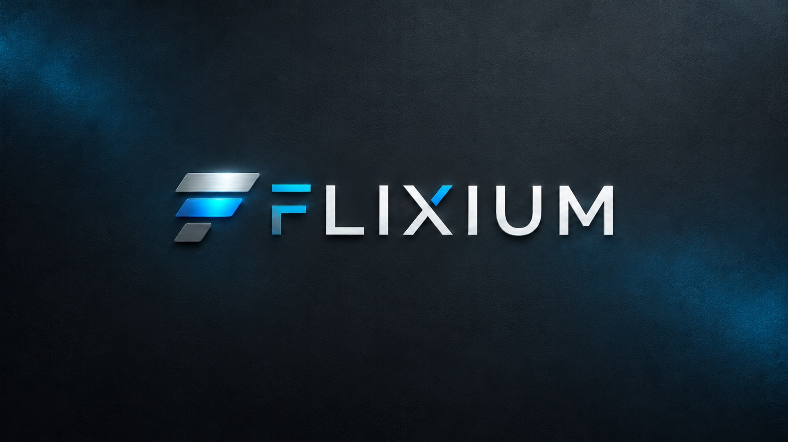

# Flixium Repo

A cinematic home for your media. Install the Flixium skin, its companion helper and native music visuals from one Kodi repository.

**[Download Flixium Repo](https://github.com/jlrd221108/Flixium-Repo/releases/download/v1.0.0/repository.flixium-1.0.0.zip)** · **[Installation guide](docs/INSTALL.md)** · **[Report an issue](https://github.com/jlrd221108/Flixium-Repo/issues/new/choose)**

## Install

1. Download `repository.flixium-1.0.0.zip` using the link above.
2. In Kodi, enable **Settings → System → Add-ons → Unknown sources** if needed.
3. Open **Add-ons → Install from zip file** and select the downloaded ZIP.
4. Choose **Install from repository → Flixium Repo → Look and feel → Skin → Flixium**.
5. Accept the dependencies and switch to Flixium when prompted.

Kodi automatically installs Flixium Helper and the visualizer build matching **Kodi's own architecture**. You do not install multiple visualizer builds. Pillow comes from Kodi's official repository, which should remain enabled.

Prefer Kodi's File Manager? Add **`https://jlrd221108.github.io/Flixium-Repo/`** as a source, then choose the repository ZIP from it.

## Included

| Add-on | Version | Purpose |
| --- | --- | --- |
| Flixium | 1.1.23 | Cinematic views, artwork-led browsing and customisable home screens |
| Flixium Helper | 1.0.44 | Artwork processing, colours and caching |
| Flixium Visualizer | 1.1.2 | Animated cover backgrounds and GPU-rendered timed lyrics |
| Flixium Repo | 1.0.0 | Dependency installation and updates |

The music OSD includes word highlighting, held-letter emphasis, line transitions, instrumental dots, TTML duet/backing-vocal layout and an optional Simple Lyrics mode. Individual effects and background quality can be adjusted for lower-powered devices. Lyric files need suitable timing data for word-level effects.

## Compatibility

| Kodi 21 platform | Native build | Verification |
| --- | --- | --- |
| Windows x64 | D3D11 | Build, shader checks and local Kodi playback |
| Android ARM64 | OpenGL ES 2 | Cross-build and package checks; device playback pending |
| Android ARMv7 | OpenGL ES 2 | Cross-build and package checks; device playback pending |
| Android x86 | OpenGL ES 2 | Cross-build and package checks; device playback pending |
| Android x86-64 | OpenGL ES 2 | Cross-build and package checks; device playback pending |

Android builds target API 21 (Android 5.0+) and require compatible Kodi/GPU drivers. A 64-bit device can run 32-bit Kodi; selection follows Kodi. Linux, macOS, Windows ARM and other Kodi major versions are not supported by this release. The feed is limited to Kodi 21 to avoid offering an unverified native ABI.

## Updates and downloads

Keep the repository enabled for updates. Every package has a SHA-256 checksum; repository metadata is also SHA-256 verified. Large packages live in [GitHub Releases](https://github.com/jlrd221108/Flixium-Repo/releases), keeping this Git repository lightweight. Only the matching native build downloads to a device.

Manually installed add-ons from another private repository may keep their old update origin. Open the add-on's **Versions** screen and select the entry from Flixium Repo to switch origins. [Kodi documents repository update origins here](https://kodi.wiki/view/About_Add-ons).

## Project information

- [Installation and troubleshooting](docs/INSTALL.md)
- [How platform selection and releases work](docs/DEVELOPMENT.md)
- [Release notes](CHANGELOG.md)
- [Licenses and credits](docs/LICENSES.md)
- [Contributing](CONTRIBUTING.md) · [Security](SECURITY.md)

The repository tooling is MIT licensed. Distributed add-ons retain their own GPL, AGPL, Creative Commons and third-party notices; they are not relicensed by this repository. Corresponding source is provided with each release.

Flixium is an independent project and is not affiliated with Team Kodi, Spotify, Spicetify or Apple. No films, music, streams or media subscriptions are included.
